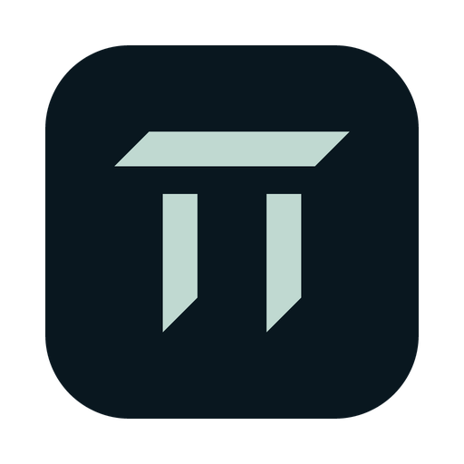
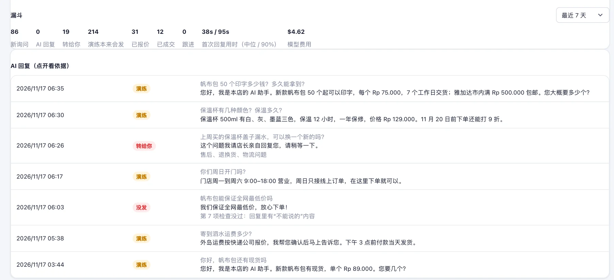
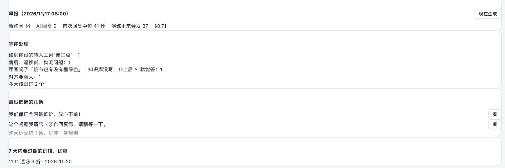

# TonyTrade AI – WhatsApp, WeChat & Xiaohongshu AI Customer Service Automation

**English** · [简体中文](https://github.com/TonyTrade-AI/tonytrade-ai/blob/main/README.zh-CN.md)

**Customers ask, the AI answers in seconds. You sleep, it stays on shift. One person runs five phones and several platforms.**

TonyTrade AI is **AI customer service automation software** for Mac and Windows. Plug in your Android phone with a USB cable and get **WhatsApp auto-reply, WeChat automation and Xiaohongshu automation** in one app.

### 👉 [Start the free 3-day trial](https://tonytrade.com/tonytrade-ai/download/) · [Buy now – US$99/year](https://tonytrade.com/tonytrade-ai/pricing/)

> **About this repository:** this repository is a product introduction and a place to report problems. It **does not contain source code**. TonyTrade AI is commercial software, all rights reserved. Download and buy only from **[tonytrade.com](https://tonytrade.com/tonytrade-ai/)**.

---

## What it gets done

- **WhatsApp auto-reply:** price, opening hours, how to order – common questions get your approved answer automatically, word for word.
- **AI replies in seconds:** the AI drafts answers in the customer's own language.
- **WeChat automation:** every new WeChat message gets an AI-written reply ready to send.
- **Xiaohongshu automation:** daily likes, saves and follows from your list, on autopilot.
- **No made-up answers:** prices and promises come only from your notes; anything unsure comes to you.
- **One tap, sent for you:** approve once and the software types and sends on the phone.
- **No lead left behind:** every enquiry tracked, with follow-up reminders.
- **Night shift covered:** overnight messages are caught and answered in draft, with a one-page report each morning.
- **One person, many phones:** up to five Android phones on one computer, with one button to stop everything.

For what each platform supports today, see the [download page](https://tonytrade.com/tonytrade-ai/download/). Screenshots and demos are on the [official website](https://tonytrade.com/tonytrade-ai/).

## Screenshots

*Demo data, rehearsal mode, Chinese interface.*

**AI reply log**

**Morning report**

## Who it is for

- **Shops and service businesses** answering the same questions all day.
- **Exporters and trading companies** with buyers writing in many languages.
- **Sellers serving Chinese customers** on WeChat and Xiaohongshu.
- **Owners who are offline at night** but still get enquiries from other time zones.

## Requirements

| Item | Details |
|---|---|
| Computer | Mac with Apple silicon (M1 or later; Intel Macs not supported), or Windows PC (x64 or ARM) |
| Phone | An Android phone. iPhone is not supported |
| Cable | USB data cable plugged directly into the computer |
| Apps | Standard WhatsApp app (WhatsApp Business not supported at present), WeChat, Xiaohongshu |
| AI model | Your own API key from a provider you choose, or a local model. Model fees are paid to the provider |

## Get started in three steps

1. **[Sign up and download](https://tonytrade.com/tonytrade-ai/download/)** for Mac or Windows.
2. Connect your Android phone and choose **Start trial** in the software – 3 days, every feature, free.
3. Like it? **[Buy a licence](https://tonytrade.com/tonytrade-ai/pricing/)** and keep going.

## Pricing

| Phones | Price per year |
|---|---|
| 1 phone | US$99 |
| 2 phones | US$198 |
| 3 phones | US$297 |
| 4 phones | US$396 |
| 5 phones (the most on one computer) | US$495 |

Every feature is included, with one computer and updates during your licence year. Paid once by card. **No automatic renewal.** AI model fees, phones and SIM cards are not included. Current prices: [pricing page](https://tonytrade.com/tonytrade-ai/pricing/).

## FAQ

**Does it work with iPhone?**
No. It needs an Android phone. Your customers can use any phone.

**Is the AI model included in the price?**
No. You choose a provider and pay them directly, or run a model on your own computer at no model cost.

**Will the AI make up prices or promises?**
No. Prices and promises must match what you wrote; if they do not, the reply comes to you instead.

**Where is my customer data stored?**
On your computer. TonyTrade does not receive your conversations.

**Can my account be banned?**
Automated use carries some account risk, and no software can promise otherwise. TonyTrade AI works within cautious limits; please read the [safety design](https://tonytrade.com/tonytrade-ai/safety/) before you start.

More answers: [FAQ](https://tonytrade.com/tonytrade-ai/faq/).

## Support and feedback

- Email: **support@tonytrade.com**
- Found a problem? Open an [issue](https://github.com/TonyTrade-AI/tonytrade-ai/issues) in this repository. Please **do not post** customer names, phone numbers, chat content, licence details or API keys.

---

### [Start your free trial at tonytrade.com →](https://tonytrade.com/tonytrade-ai/)

© TonyTrade AI. All rights reserved. This repository contains no source code and is not open source; no licence is granted to copy, modify or redistribute the software.
