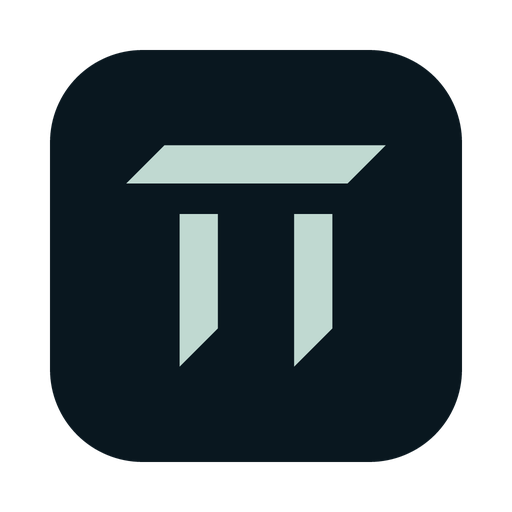

# TonyTrade AI：微信、小红书、WhatsApp AI 客服自动化软件

[English](https://github.com/TonyTrade-AI/tonytrade-ai/blob/main/README.md) · **简体中文**

**客户来问，AI 秒写回复。老板睡觉，它在值班。一个人，管 5 部手机、多个平台。**

TonyTrade AI 是 Mac / Windows 上的 **AI 客服自动化软件**，一根 USB 线连上你的安卓手机：**微信自动化、小红书自动化运营、WhatsApp 自动回复**，全在一个软件里。

### 👉 [免费试用 3 天](https://tonytrade.com/zh/tonytrade-ai/download/) · [立即购买：99 美元一年](https://tonytrade.com/zh/tonytrade-ai/pricing/)

> **关于本仓库：** 这里只是产品介绍和问题反馈，**不含任何源代码**。TonyTrade AI 是商业软件，保留所有权利。请只在官网 **[tonytrade.com](https://tonytrade.com/zh/tonytrade-ai/)** 下载和购买。

---

## 能帮你做成什么

- **微信自动化：** 客户一来消息，AI 立刻把回复写好，你看一眼就发，再也不用一句句敲。
- **小红书自动化运营：** 按你的名单每天自动点赞、收藏、关注，账号天天都在动。
- **WhatsApp 自动回复：** 价格、营业时间、怎么下单——常见问题按你批准的原文自动回，不用你动手。
- **AI 秒写回复：** 客户用什么语言问，AI 就用什么语言答。
- **不乱说话：** 价格、承诺只说你写过的，拿不准的直接交给你。
- **一键确认，自动发出：** 你点一下，软件自动在手机上打字、发送。
- **不漏一个客户：** 每个询问都记着，该跟进时提醒你。
- **夜里有人值班：** 夜里来的消息先接住、回复先写好，早上一页早报全看清。
- **一人管多机：** 一台电脑最多 5 部安卓手机，一屏看全，一键全停。

各平台当前能做什么，以官网[下载页](https://tonytrade.com/zh/tonytrade-ai/download/)的说明为准。界面和演示见[官网](https://tonytrade.com/zh/tonytrade-ai/)。

## 适合谁用

- **做国内客户、做小红书的商家**：微信消息回不过来，小红书账号要天天运营。
- **门店和服务商家**：一天到晚回同样的问题。
- **外贸和贸易公司**：海外买家各种语言来问。
- **晚上顾不上回消息的老板**：时差另一头的客户夜里也在问。

## 需要准备什么

| 项目 | 说明 |
|---|---|
| 电脑 | Apple 芯片的 Mac（M1 及以后，不支持 Intel Mac），或 Windows 电脑（x64 或 ARM） |
| 手机 | 安卓手机，不支持 iPhone |
| 数据线 | USB 数据线，直接插电脑 |
| App | 微信、小红书、普通版 WhatsApp（目前不支持 WhatsApp Business 版） |
| AI 模型 | 你自己选服务商的 API Key，或本机模型；模型费用付给服务商 |

## 三步开始

1. **[注册并下载](https://tonytrade.com/zh/tonytrade-ai/download/)** Mac 或 Windows 版。
2. 连上安卓手机，在软件里点 **“开始试用”**——3 天全功能免费。
3. 好用就 **[购买授权](https://tonytrade.com/zh/tonytrade-ai/pricing/)**，接着用。

## 价格

| 手机数 | 每年价格 |
|---|---|
| 1 部 | 99 美元 |
| 2 部 | 198 美元 |
| 3 部 | 297 美元 |
| 4 部 | 396 美元 |
| 5 部（一台电脑最多） | 495 美元 |

所有功能都包含，含 1 台电脑和授权期内的更新。银行卡一次付清，**不自动续费**。不含 AI 模型费用、手机、SIM 卡和流量。价格以[官网价格页](https://tonytrade.com/zh/tonytrade-ai/pricing/)为准。

## 常见问题

**支持 iPhone 吗？**
不支持，要用安卓手机。你的客户用什么手机都可以。

**AI 模型费用包含在价格里吗？**
不包含。你自己选服务商、直接付给它；也可以在自己电脑上跑模型，不花模型费。

**AI 会不会乱报价、乱承诺？**
不会。价格和承诺必须和你写的资料对得上，对不上就不发，转给你。

**客户数据存在哪？**
存在你自己电脑上。TonyTrade 拿不到你的聊天记录。

**会不会封号？**
自动操作对账号有一定风险，没有软件能保证不封号。TonyTrade AI 按保守的上限操作，开始前请看[安全设计](https://tonytrade.com/zh/tonytrade-ai/safety/)。

更多问题见[常见问题](https://tonytrade.com/zh/tonytrade-ai/faq/)。

## 支持和反馈

- 邮箱：**support@tonytrade.com**
- 遇到问题可以在本仓库提 [Issue](https://github.com/TonyTrade-AI/tonytrade-ai/issues)。请**不要贴**客户姓名、电话、聊天内容、授权信息或 API Key。

---

### [立即到 tonytrade.com 免费试用 TonyTrade AI →](https://tonytrade.com/zh/tonytrade-ai/)

© TonyTrade AI，保留所有权利。本仓库不含源代码，不是开源项目，不授予复制、修改或再分发本软件的任何许可。
